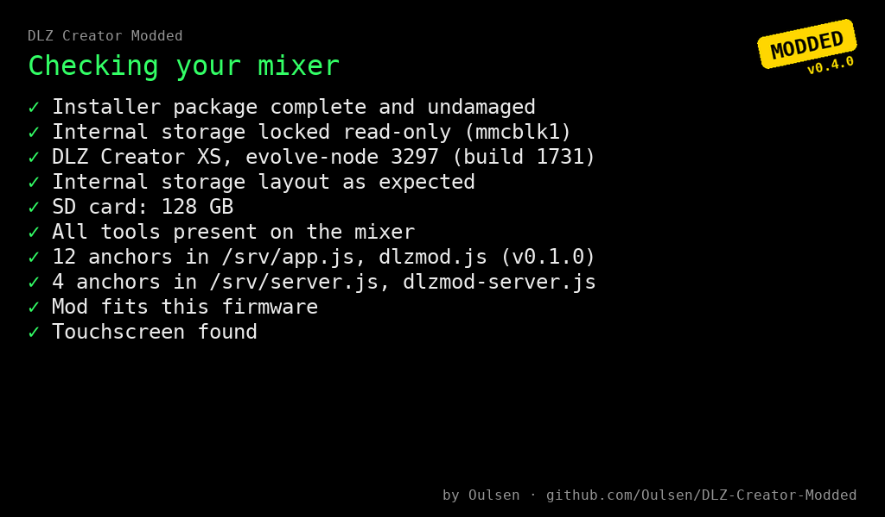
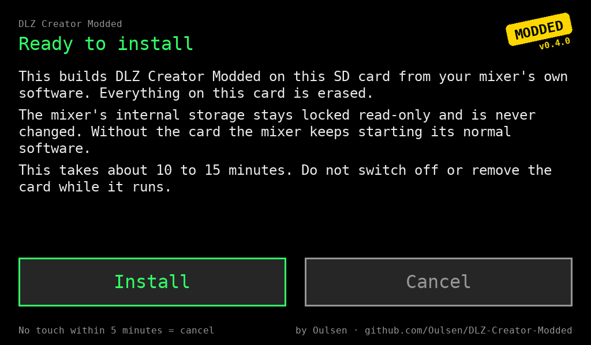
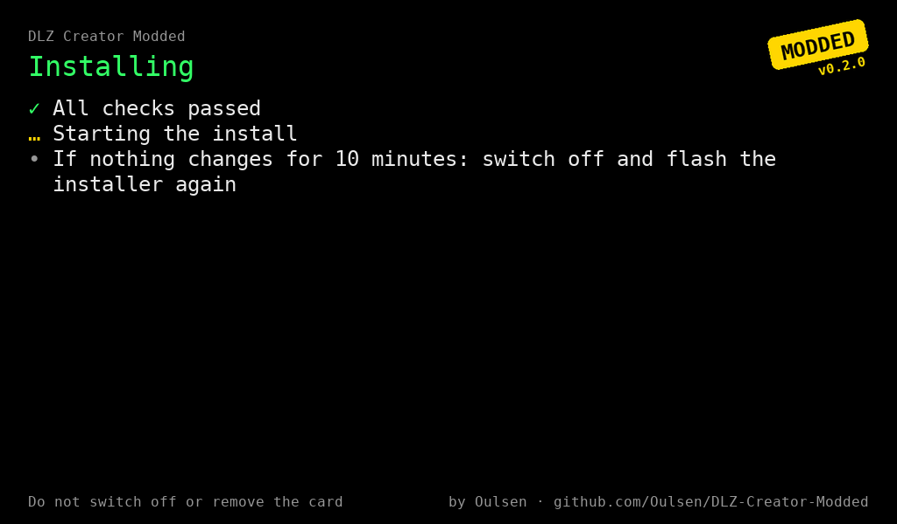
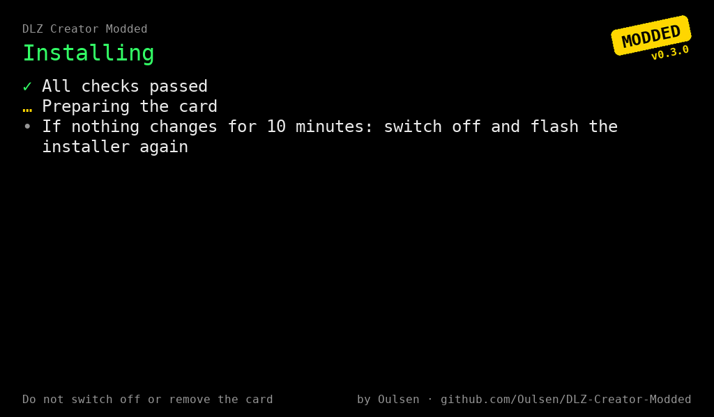
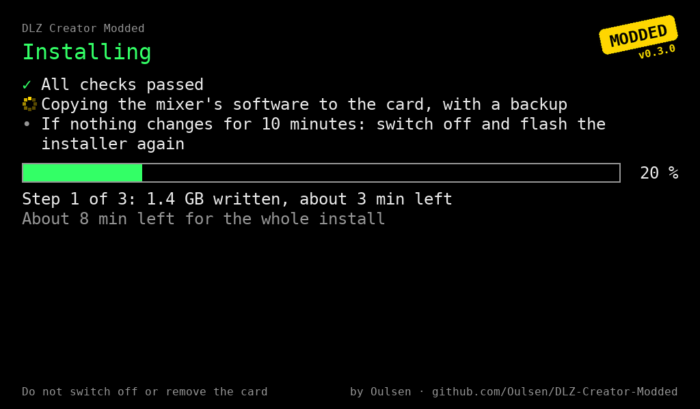
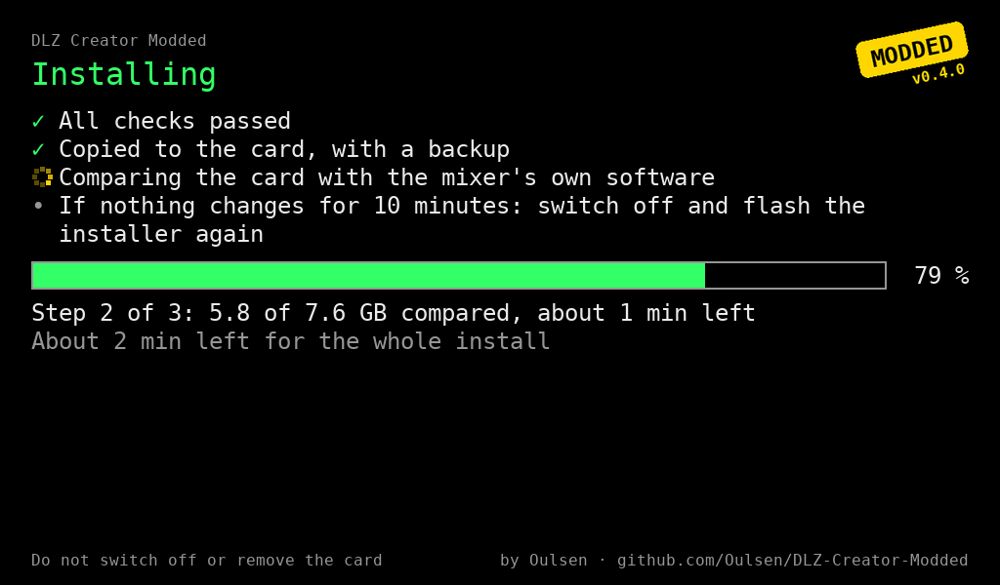
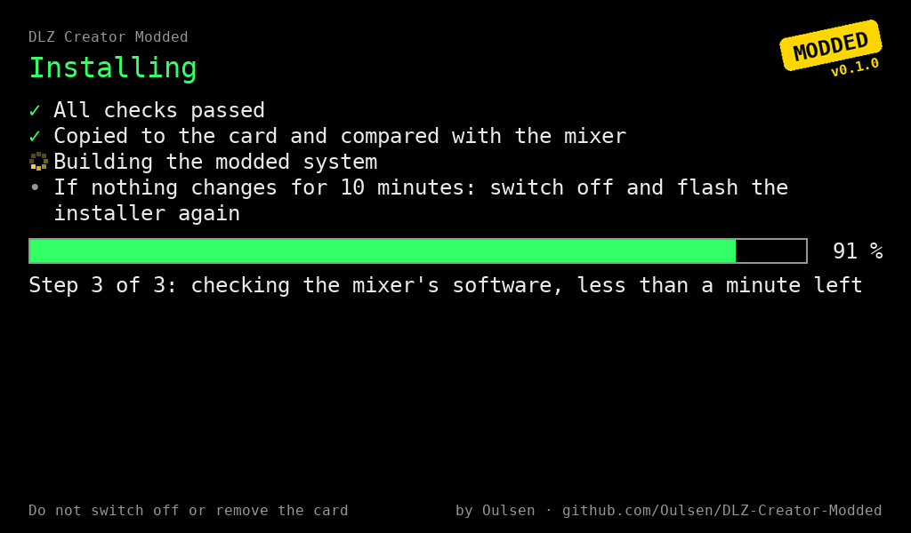
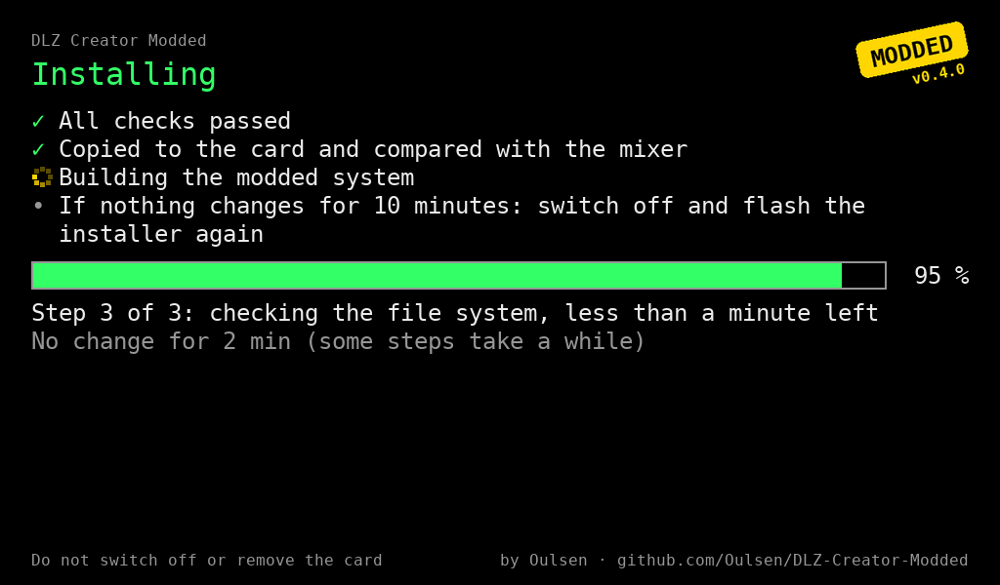
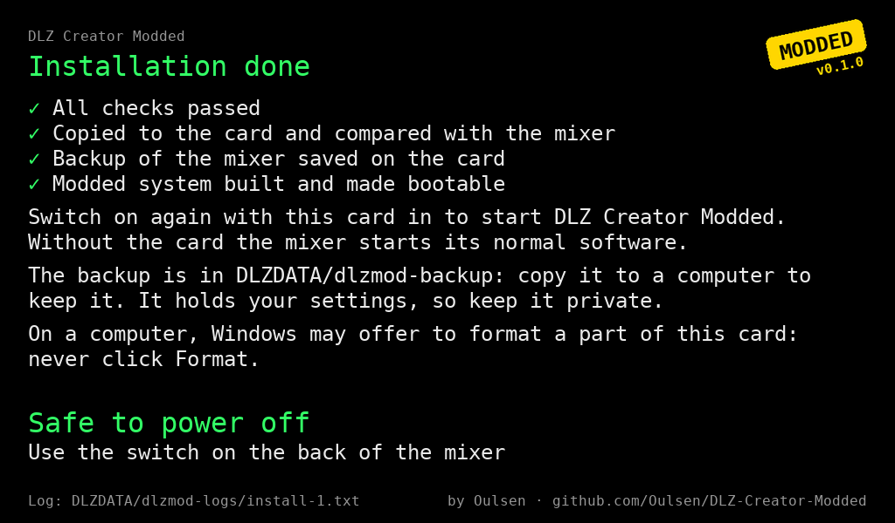
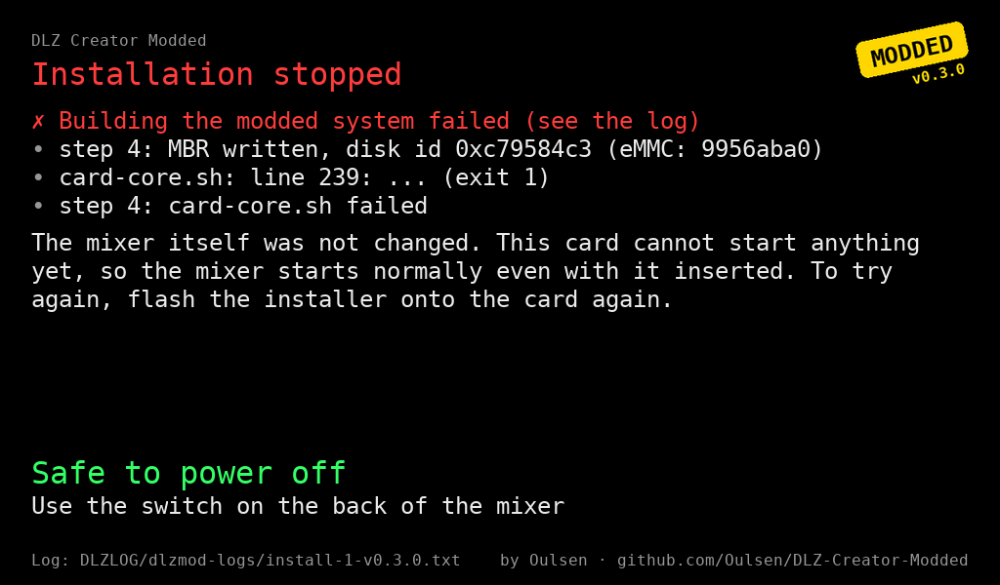

# Installing DLZ Creator Modded

This guide takes you from a blank microSD card to a mixer running DLZ Creator Modded. You only need
a computer to write one file to the card; the mixer does the rest itself, on its own screen.

**How it works in one paragraph:** the installer card starts the mixer, checks it, and builds the
modded system on the same card from your mixer's own software. The mixer's internal storage is locked
read-only the whole time and is never changed. Afterwards, **with the card in** the mixer starts DLZ
Creator Modded; **without the card** it starts its normal Mackie software, exactly as before.

> Unofficial, alpha, at your own risk: read [DISCLAIMER.md](../DISCLAIMER.md) first.

## What you need

- **A Mackie DLZ Creator XS or DLZ Creator with firmware 1.2.0** (build 1731, shown in Settings →
  About). The full-size DLZ Creator has the same main board and firmware as the XS; an owner has
  installed and run the mod on one, but our own test mixer is an XS (reports from full-size owners
  are welcome). Other
  firmware versions are not supported: the installer checks this and does not install. It can save a
  backup for analysis instead, see
  [Other firmware: backup for analysis](#other-firmware-backup-for-analysis).
- **A microSD card**: 16 GB at least, **64 GB or more recommended** (32 GB or more if you want to
  record to it). An A1 or A2 card from a known brand; see
  [Known good cards](../README.md#known-good-cards). **Everything on the card is erased.**
- **A card reader** for your computer.
- **The installer image** `dlz-installer-v….img` from the
  [latest release](https://github.com/Oulsen/DLZ-Creator-Modded/releases/latest).
- A free tool to write the image: [balenaEtcher](https://etcher.balena.io/) or
  [Raspberry Pi Imager](https://www.raspberrypi.com/software/).
- Optional: a USB Wi-Fi stick, if you want Wi-Fi (the mixer has none of its own); see
  [Known good Wi-Fi sticks](../README.md#known-good-wi-fi-sticks).

> ### ⚠ Never click "Format"
> When the card is in your computer, **Windows may say a drive needs to be formatted. Never click
> Format.** Close that window with Cancel. Part of the card is in a format Windows cannot read; that
> is normal. Formatting it destroys the mod (and, after the install, maybe your recordings).

## 1. Write the installer to the card

Writing an image to a card is also called "flashing"; the installer's screens use that word.

1. Put the microSD card in the card reader.
2. Open balenaEtcher (or Raspberry Pi Imager, "Use custom").
3. Choose the downloaded `dlz-installer-v….img`, choose your card, and write. Double-check that you
   picked the card and not another drive.
4. When it is done, eject the card. If Windows asks to format a drive: **Cancel**.

## 2. Start the installer on the mixer

1. Switch the mixer **off** (switch on the back).
2. Put the card in the mixer's microSD slot.
3. Switch the mixer **on**. After a few seconds the installer's screen appears instead of the normal
   start-up.

## 3. Follow the screens

The whole install takes **about 10 to 15 minutes**, depending on the card. Do not switch off or
remove the card while it runs.

### Checks

The installer checks the mixer, its firmware, its internal storage and the card, one line at a
time. Every line should get a green ✓. If a line turns red ✗, the installer stops before writing
anything; see [If the installation stops](#if-the-installation-stops). On the full-size DLZ Creator the
third line says DLZ Creator ([screen](images/install/01b-checks-full-size.png)).

### Ready to install

Read the text, then tap **Install** to start or **Cancel** to stop. Cancel (or not touching the
screen for 5 minutes) writes nothing: the screen says **Cancelled** and you can switch off and take
the card out.

### Installing

The card is prepared first. Then three steps follow, each with a progress bar, the time left for
that step and for the whole install:

**Step 1 of 3, copying.** The mixer's software is copied to the card. At the same time a backup of
the mixer's internal storage is saved on the card. The screen counts what has been written to the
card, the copy and the backup together.

**Step 2 of 3, comparing.** Everything on the card is read back and compared with the mixer, so a
bad card is caught now and not later.

**Step 3 of 3, building.** The modded system is built on the card and made bootable.

Some steps take a while without the bar moving. The screen then says how long nothing has changed;
that is fine. The ring of dots in front of the current step keeps turning as long as the installer
is working.

**If nothing changes for 10 minutes**, switch off and start again from
[step 1](#1-write-the-installer-to-the-card). (After 45 minutes the installer switches the mixer off
by itself.)

### Done

When the screen says **Safe to power off**, switch the mixer off with the switch on the back. The
mixer has no other way to switch off; this is normal.

## 4. After the install

- **Switch on with the card in** to start DLZ Creator Modded. The start-up screens show the
  **MODDED** sticker.
- In **Settings** you find the mod's own page with its options and the version.
- **The card stays in the mixer.** Taking it out and switching on starts the normal Mackie software.
- **The card belongs to this mixer.** In another mixer (also another DLZ Creator of the same model) it
  shows a red message and the mixer stays silent: the card was made from this mixer's own software,
  and its sound hardware is set up only for it. To use the mod on another mixer, install it there
  with its own card. The same message appears when the mixer itself got a Mackie update after the
  install (with the card taken out): its firmware no longer matches the card's copy.
- The part of the card named **DLZDATA** is the one your computer can read. It holds:
  - `dlzmod-backup/`: the backup of your mixer's internal storage (about 1 GB).
    **Copy this folder to your computer and keep it.** It holds your settings (including the lock
    PIN), so don't post it anywhere.
  - `dlzmod-logs/`: the install log (`install-1-vX.Y.Z.txt`: its number, then the mod version), a picture of the installer's last
    screen (`screen-1.png`) and start-up logs. Add these to a bug report.
  - Your recordings, when you record to the SD card.
- Again: when the card is in your computer, **never click Format** in a Windows prompt.
- **Updates keep your recordings**: when a release has update files, copy both
  (`dlzmod-vX.Y.Z.tar` and `dlzmod-vX.Y.Z.tar.sig`) into `DLZDATA/dlzmod-update/` and switch on.
  The screen asks whether to install it: tap **Install**, then switch the mixer off and on with the
  switch on the back. The update installs while the logo shows (about 15 seconds), then a message
  says whether it worked. **Later** keeps it on the card; the question comes back at the next start,
  and Settings → DLZ Creator Modded → **Mod** has an **Install Update...** button meanwhile. (An
  update from v0.1.0 installs at the first start without asking: the question comes with the update.)
  A release with only the installer image needs a full install (its notes say so): writing the
  installer to the card again erases the whole card, **recordings included**: copy them to your
  computer first.

## If the installation stops

A stopped install shows a red **Installation stopped** screen with the reason, and **Safe to power
off**. **Your mixer itself is never changed**, whatever the screen says.

What to do depends on the text under the red lines:

| The screen says | What it means | What to do |
|---|---|---|
| "Nothing was written to the mixer or the card (only the log)" | Stopped during the checks, for example an unsupported firmware or a card that is too small | Fix the cause it names, or switch off and take the card out: the mixer starts normally |
| "This card cannot start anything yet, so the mixer starts normally even with it inserted" | Stopped while writing the card | Write the installer to the card again ([step 1](#1-write-the-installer-to-the-card)) and retry. If it stops again at the same point, try another card |
| "Remove this card before switching on again" | Stopped at the very last step | **Take the card out before switching on.** Then write the installer to it again and retry |

The log is named at the bottom of the screen: `DLZDATA/dlzmod-logs/install-1-vX.Y.Z.txt`, or
`DLZLOG/dlzmod-logs/install-1-vX.Y.Z.txt` when it stopped before DLZDATA was made. Next to it the installer
saves a picture of its last screen, `screen-1.png`. Put the card in your computer to read them (and
**never click Format**). Only when the bottom of the screen says "Log: not saved" is there no log and
no picture: then take a photo of the screen.

Still stuck? Open an [issue](https://github.com/Oulsen/DLZ-Creator-Modded/issues) with the log,
`screen-1.png` (or your photo) and your card's exact name and size, or ask on
[Discord](https://discord.gg/Qa2fjzVbGp).

## Going back to the normal Mackie software

Switch off, take the card out, switch on. That's it: the mod lives only on the card, and the mixer's
own software was never changed. Put the card back in to use the mod again.

## Other firmware: backup for analysis

Mackie lists two current firmware builds, 1731 and 1794. The mod supports 1731; which mixers run
1794, and what differs, is unknown. On a mixer with other firmware the installer can instead save a
copy of the mixer's internal storage, so we can find out whether the mod can support it. That is the
goal, but no promise: it depends on what the backup shows.

**Not tried on such a mixer yet.** The installer only offers the backup when the mixer's own
start-up software is exactly the one we know. As always, the mixer's internal storage is only read,
never changed. Still: you would be the first, at your own risk.

1. Write the installer to a microSD card of **16 GB or more**, the same card as for an install
   ([step 1](#1-write-the-installer-to-the-card)).
2. Put the card in the mixer and switch on. After the checks the screen says **Not supported by the
   mod** and **A backup for analysis is possible**.
3. Tap **Save backup**. Saving takes a few minutes; then the screen says **Backup saved** and
   **Safe to power off**. Switch off and take the card out: the mixer starts normally.
4. Put the card in your computer (**never click Format**). Next to the installer there is a second
   drive, `DLZDUMP`, with the folder `backup-1`: the backup (`emmc-user.img.zst`), `README.txt` and
   `hardware.txt`.

The backup holds your settings, presets and the lock PIN: keep it private. To help, upload the
folder (Google Drive, OneDrive, WeTransfer or similar) and send the link **privately** via
[Discord](https://discord.gg/Qa2fjzVbGp). Never post the link in public.

If the screen says **Not supported** and no backup is offered, the mixer differs from what we know:
the installer saved a hardware report, `dlzmod-logs/hardware-1.txt` on the card (no passwords,
serial numbers or network addresses in it). Sending that via Discord helps too. If the screen stays
dark or does not react to touch: switch off and take the card out; nothing was written to the mixer.
